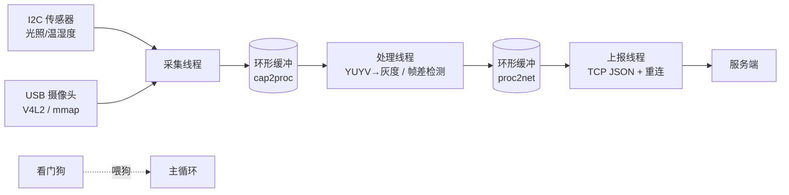

# 资源受限边缘视觉采集终端 · Edge Vision Terminal

> 跑在 **i.MX6ULL（Cortex-A7 800MHz / 512MB）** 上的边缘视觉采集终端：在极限资源下实现「采集 → 处理 → 上报」完整链路，并把**端到端延迟压到最低**。

一个项目覆盖 **嵌入式 Linux / 影像·相机 / 车载 / 端侧 AI** 四类岗位方向。
配套《项目技术规格书 · 资源受限边缘视觉采集终端》与《就业方向定制推荐 · 终版 V3》使用。

---

## 目录
- [项目简介](#项目简介)
- [系统架构](#系统架构)
- [目录结构](#目录结构)
- [环境搭建](#环境搭建)
- [编译与运行](#编译与运行)
- [功能模块与进度](#功能模块与进度)
- [性能数据](#性能数据)
- [开发路线图](#开发路线图)
- [参考资料](#参考资料)

---

## 项目简介

在 800MHz 单核、512MB 内存的极限资源下，实现：
- **数据采集**：USB 摄像头 V4L2 mmap 零拷贝采集 YUYV；I2C 传感器（光照/温湿度）周期采集
- **多线程 pipeline**：采集 → 处理 → 上报三线程，环形缓冲解耦
- **图像预处理**：自写 YUYV→灰度（不用 OpenCV）、帧差法移动侦测
- **延迟测量**：分段打点，统计均值/P95/最大
- **性能优化**：定位热点 → 查表法/降采样/缓冲复用，产出优化前后对比
- **网络上报**：TCP JSON + 指数退避重连 + 断网缓存补传
- **系统可靠性**：优雅关机、看门狗、24h 稳定性验证

**核心指标**：端到端延迟 · CPU 占用 · 帧率 · 内存 · 稳定性

---

## 系统架构



数据流（文字版）：**传感器/I2C、摄像头/V4L2 → cap2proc 环形缓冲 → 处理线程(格式转换+检测) → proc2net 环形缓冲 → 上报线程(socket) → 服务端**；全程由 `perf` 分段打点，主循环周期性喂看门狗。

---

## 目录结构

```
edge-vision-terminal/
├── README.md                 # 本文件：架构、环境、运行、性能数据
├── Makefile                  # 支持本地与交叉编译
├── .gitignore
├── src/
│   ├── main.c                # 入口：初始化、信号处理、主循环
│   ├── v4l2_capture.c/.h    # V4L2 采集模块（mmap 零拷贝）
│   ├── sensor.c/.h           # I2C 传感器采集
│   ├── ringbuf.c/.h          # 环形缓冲（2^n 容量 + 位运算）
│   ├── pipeline.c/.h         # 多线程编排
│   ├── image_proc.c/.h       # YUYV→灰度、帧差检测（自写，不用 OpenCV）
│   ├── perf.c/.h             # 延迟测量与统计
│   ├── net_report.c/.h       # socket 上报、断线重连
│   └── watchdog.c/.h         # 看门狗、优雅退出
├── tools/
│   ├── perf_plot.py          # 性能数据可视化（出图放 README）
│   └── quantize_exp.py       # PC 端 INT8 量化实验
├── docs/
│   ├── architecture.md       # 架构说明与数据流图
│   └── benchmark.md          # 优化前后对比数据（重要）
└── demo/
    └── demo.mp4              # 1-2 分钟演示（待录）
```

---

## 环境搭建

- **宿主机**：Ubuntu 22.04 虚拟机（或 WSL2）
- **交叉编译工具链**：`arm-linux-gnueabihf-gcc`（i.MX6ULL 为 ARM32）
- **目标板**：i.MX6ULL 开发板，烧录带 V4L2 / I2C / watchdog 支持的固件，`ssh` 登录
- **验证工具**：`v4l2-ctl`、`i2c-tools`、`uvc_stream`（摄像头先行验证用）

> W1 最小一步：装好 Ubuntu 虚拟机与交叉编译工具链，不依赖板子到货。

---

## 编译与运行

```bash
# 本地编译（PC 上验证逻辑，无摄像头时各模块有 TODO 占位）
make

# 交叉编译到 i.MX6ULL
make CC=arm-linux-gnueabihf-gcc

# 运行（板端）
./edge-vision

# 清理
make clean
```

编译选项：`-std=c99 -Wall -Wextra -O2 -pthread -g`。性能剖析可加 `-pg`（gprof）。

---

## 功能模块与进度

| # | 模块 | 状态 | 对应岗位 |
|---|------|------|----------|
| ① | 数据采集（V4L2 + I2C） | 🔲 待做 (W1/W3) | Linux 应用层 / 影像 |
| ② | 多线程 pipeline + 环形缓冲 | 🔲 待做 (W2) | Linux 应用层 / 车载 |
| ③ | 图像预处理（YUYV→灰度、帧差） | 🔲 待做 (W3) | 影像 / 机器视觉 |
| ④ | 延迟测量 | 🔲 待做 (W3) | 系统软件 / 性能 |
| ⑤ | 性能优化（核心） | 🔲 待做 (W4) | 系统软件 / 性能 |
| ⑥ | 网络上报 + 重连 | 🔲 待做 (W5) | Linux 应用层 / 车载 |
| ⑦ | 系统可靠性（看门狗/优雅关机） | 🔲 待做 (W5) | 系统软件 / 车载 |
| ⑧ | PC 量化实验（选做·AI） | 🔲 选做 | 端侧 AI |
| ⑨ | WEB 监控界面（选做） | 🔲 选做 | 全岗位加分 |

---

## 性能数据

> **这是整个项目唯一能让人记住的东西——必须填入真实数字。**

优化前后的端到端延迟、CPU 占用、帧率、内存对比见 [`docs/benchmark.md`](docs/benchmark.md)。

| 指标 | 优化前 | 优化后 | 提升 |
|------|--------|--------|------|
| 端到端延迟 (ms) | _待填_ | _待填_ | _待填_ |
| CPU 占用 (%) | _待填_ | _待填_ | _待填_ |
| 帧率 (fps) | _待填_ | _待填_ | _待填_ |
| 内存 VmRSS (KB) | _待填_ | _待填_ | _待填_ |

---

## 开发路线图

| 周 | 时间 | 目标 | 交付 |
|----|------|------|------|
| W1 | 10.19–10.25 | 环境 + I2C 传感器采集 | 命令行周期打印传感器数据 |
| W2 | 10.26–11.01 | 多线程 pipeline + 环形缓冲 | 多线程无丢数据、无竞态 |
| W3 | 11.02–11.08 | V4L2 + 图像处理 + 延迟基线 | 灰度图 + 延迟基线数据 |
| **W4** | **11.09–11.15** | **性能优化（决定成败）** | **优化前 vs 后 三项对比** |
| W5 | 11.16–11.22 | 可靠性 + 通信 + 量化 + 仓库 | 完整仓库 + 稳定性报告 + 演示视频 |
| W6 | 11.23–11.30 | 面试 + 补强 + 多版本简历 | 简历定稿，能扛 30 分钟追问 |

> 11 月中即开始边投边做，不必等项目完美。

---

## 参考资料

- 《项目技术规格书 · 资源受限边缘视觉采集终端》
- 《就业方向定制推荐 · 终版 V3》
- 内核文档：`Documentation/userspace-api/media/v4l/`
- i.MX6ULL 参考手册（NXP）

---
_项目自 2026.10.19 启动，遵循规格书 6 周执行计划。_
